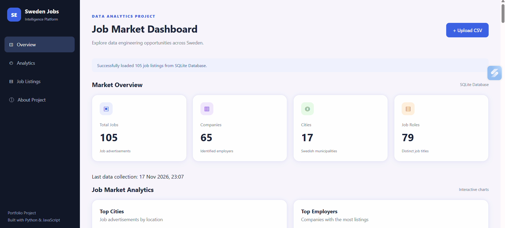

# Sweden Job Market Intelligence Platform

A full-stack job market analytics application that collects, processes, analyzes, and visualizes Data Engineering job advertisements in Sweden.

The platform uses job advertisement data from Sweden's JobTech API to explore hiring trends, technical skills, companies, and geographic demand.

### Live Demo

🌐 **[View Live Dashboard](https://sweden-job-market-intelligence.pothularajasekhar72.workers.dev/)**

📂 **[GitHub Repository](https://github.com/Rajashekar664/sweden-job-market-intelligence)**

**Deployment:** Render (Free Plan)

> **Note:** The free hosting service may take some time to wake up after inactivity.


## Dashboard Preview




## Features

- **Job Market Dashboard:** Interactive statistics and visualizations of job advertisements.
- **Job Search:** Filter advertisements by keyword, city, and company.
- **Technical Skills Analysis:** Analyze mentions of Python, SQL, Azure, AWS, Databricks, and other technologies in job descriptions.
- **Job Details:** View individual advertisements and full job descriptions.
- **Swedish-to-English Translation:** Translate Swedish job descriptions offline using Argos Translate.
- **Translation Caching:** Store English translations in SQLite to avoid repeated processing.
- **Data Synchronization:** Update job records and remove outdated advertisements.
- **CSV Export:** Download job advertisements matching the selected filters.
- **PDF Report:** Generate and download a summary of job market statistics.
- **Collection Timestamp:** Display when job advertisements were last collected.


## Technology Stack

| Layer | Technologies |
|---|---|
| Programming Language | Python |
| Data Collection | Requests, Sweden JobTech API |
| Data Processing | Pandas |
| Database | SQLite |
| Backend | Flask, REST APIs |
| Frontend | HTML, CSS, JavaScript |
| Data Visualization | Chart.js |
| Machine Translation | Argos Translate |
| PDF Generation | ReportLab |
| Production Server | Gunicorn |
| Cloud Hosting | Render |
| Version Control | Git, GitHub |
| Search Engine Integration | Google Search Console |


## Project Structure

sweden-job-market-intelligence/
│
├── src/
│   ├── dashboard/
│   │   ├── index.html
│   │   ├── style.css
│   │   └── script.js
│   │
│   ├── app.py
│   ├── fetch_jobs.py
│   ├── create_database.py
│   ├── analyze_skills.py
│   ├── install_translation_model.py
│   ├── add_translation_cache.py
│   ├── pretranslate_jobs.py
│   ├── export_translations.py
│   ├── import_translations.py
│   └── generate_report.py
│
├── data/                  # Generated job data
│   ├── jobs.db
│   ├── sweden_jobs_cleaned.csv
│   └── skills_analysis.csv
│
├── translations.csv       # Cached English translations
├── requirements.txt       # Python dependencies
├── build.sh               # Render build script
├── .python-version        # Python version
├── .gitignore
└── README.md


## How It Works

1. Fetch Data Engineering job advertisements from the Swedish JobTech API.
2. Clean and validate the data using Pandas.
3. Save the cleaned dataset to CSV.
4. Synchronize job listings with SQLite.
5. Extract and analyze technical skill mentions.
6. Serve job data through Flask REST API endpoints.
7. Display statistics and interactive charts in the web dashboard.
8. Allow users to search, view, translate, and export advertisements.

## Getting Started

### 1. Clone the repository

```bash
git clone https://github.com/Rajashekar664/sweden-job-market-intelligence.git
cd sweden-job-market-intelligence
```

### 2. Create a Python virtual environment

```bash
python -m venv .venv
```

Activate it on Windows PowerShell:

```powershell
.\.venv\Scripts\Activate.ps1
```


### 3. Install dependencies

Install the project dependencies using `requirements.txt`:

```bash
python -m pip install -r requirements.txt
```

This installs the dependencies required by the data pipeline, Flask application, dashboard, reporting, and translation features.

**Note:** Some dependencies, particularly those used for machine translation, may require additional installation time.

```

### 4. Prepare the job dataset

```bash
python src/fetch_jobs.py
python src/create_database.py
python src/analyze_skills.py
```

These commands fetch current job advertisements, build the local SQLite database, and calculate technical skill statistics.


### 5. Set Up Swedish-to-English Translation

The platform uses Argos Translate for offline Swedish-to-English translation.

**Install the translation model:**

```bash
python src/install_translation_model.py
```

**Generate missing English translations locally:**

```bash
python src/pretranslate_jobs.py
```

**Export the saved translations:**

```bash
python src/export_translations.py
```

This creates `translations.csv`, which contains saved English translations and their corresponding original Swedish descriptions.

**How translation works on Render:**

- Translations are generated locally before deployment.
- During deployment, `src/import_translations.py` imports matching translations into SQLite.
- The dashboard displays saved English descriptions without running the translation model during web requests.
- New or modified jobs may not have English translations until the cache is updated.

This approach reduces translation processing on Render's Free service.


### 6. Generate the PDF report

```bash
python src/generate_report.py
```

### 7. Start the application

```bash
python src/app.py
```

Open your browser at:

http://127.0.0.1:5000/


## Deployment


### Static Dashboard Data Updates

The Cloudflare dashboard uses pre-generated JSON files:

- `static-site/data/jobs.json` — Job listings and cached English translations
- `static-site/data/skills.json` — Technical skills analysis
- `static-site/data/last-updated.json` — Actual data collection timestamp

The data is generated locally using Python scripts and then published to Cloudflare.

To refresh the dashboard:

1. Fetch the latest job advertisements.
2. Update the local SQLite database and skills analysis.
3. Generate and export any missing English translations.
4. Regenerate the static JSON files.
5. Upload the updated static website to Cloudflare.

The current static deployment does not update automatically.


### Hosting Architecture

The Sweden Job Market Intelligence Platform uses two hosting services:

**Cloudflare — Fast Static Dashboard**
- Hosts the public-facing HTML, CSS, JavaScript, and JSON files.
- Provides interactive job market analytics, job search, filtering, and saved English translations.
- Serves the dashboard without Flask server cold starts.

**Render — Full-Stack Application**
- Hosts the original Flask REST API and SQLite application.
- Demonstrates backend development and API integration.
- Uses Render's Free plan, which may sleep after inactivity.

### Live Links

**Fast Dashboard (Cloudflare):**
https://sweden-job-market-intelligence.pothularajasekhar72.workers.dev/

**Full-Stack Application (Render):**
https://sweden-job-market-intelligence.onrender.com/


The application is deployed on Render using GitHub for version control and automated deployment.


### Render Configuration

| Setting | Value |
|---|---|
| Hosting | Render Web Service |
| Runtime | Python |
| Build Command | `bash build.sh` |
| Start Command | `gunicorn src.app:app --bind 0.0.0.0:$PORT` |
| Plan | Free |

### Deployment Workflow

1. Changes are pushed to the GitHub `main` branch.
2. Render builds the application using `build.sh`.
3. Python dependencies are installed.
4. Current job advertisements are collected from Sweden's JobTech API.
5. The SQLite database and skill analysis are generated.
6. Saved English translations are imported from `translations.csv`.
7. The PDF report is generated.
8. Gunicorn starts the Flask application.

### Important Limitations

- Render's Free service may sleep after periods of inactivity.
- SQLite data stored on the Free service's filesystem is not persistent.
- English translations are available for jobs matching the precomputed translation dataset.
- Job statistics change as new advertisements are collected.


## API Endpoints

| Endpoint | Description |
|---|---|
| `/api/health` | Application health status |
| `/api/jobs` | Retrieve job listings |
| `/api/jobs/search` | Search by keyword, city, and company |
| `/api/jobs/<job_id>` | Retrieve one job's details |
| `/api/jobs/<job_id>/translate` | Translate a job description into English |
| `/api/stats` | Job market summary statistics |
| `/api/skills` | Technical skill frequencies |
| `/api/last-updated` | Last data collection timestamp |
| `/api/report/download` | Download the generated PDF report |

## Testing

The Flask REST API is covered by automated tests written with **pytest**. The tests run against a small temporary SQLite database, so they do not need the real job data or an internet connection.

Run the tests locally:

```bash
python -m pip install -r requirements-dev.txt
python -m pytest -v
```

The tests also run automatically on GitHub Actions for every push to `main` and every pull request (see `.github/workflows/tests.yml`).

## Data Source and Scope

Job advertisements are collected from Sweden's JobTech API.

The current collection focuses on advertisements matching a Data Engineering search query. Therefore, the results represent a subset of Swedish job advertisements, not the entire Swedish labor market.

Technical skills are identified using predefined keyword patterns. A skill mention does not necessarily mean the skill is mandatory for the position.

Job advertisements change over time, and analysis results depend on the collection date.


## Project Status

**Live and publicly accessible on Render.**

The Sweden Job Market Intelligence Platform has been developed, tested, and deployed as a full-stack web application.

### Live Application

https://sweden-job-market-intelligence.onrender.com/

### Implemented Features

- Job collection from Sweden's JobTech API
- Data cleaning and SQLite database synchronization
- Interactive job market dashboard
- Job search and filtering
- Technical skills analysis
- Swedish-to-English job description translation
- Precomputed English translation caching
- CSV export and PDF report generation
- Google Search Console verification and indexing
- Cloud deployment using Render and Gunicorn

### Deployment Notes

The application is hosted on Render's Free plan.

Job data is collected and the SQLite database is generated during deployment.

English translations are generated locally, exported to CSV, and imported into SQLite during deployment for matching job descriptions.

New or changed advertisements may not have a cached English translation until the translation dataset is updated.

Render's Free service may take additional time to respond after a period of inactivity.

### Future Improvements

- Automated data collection and translation updates
- Persistent database storage
- Historical job market trend analysis
- Additional dashboard improvements


## Author

Developed as a portfolio project demonstrating Python data engineering, REST API development, relational databases, data visualization, and full-stack application development.

## Collaboration

This project is being developed collaboratively using Github branches and pull request


## Team Contributions

This project is developed collaboratively by two developers, with responsibilities divided equally.

### Saisri Yenuganti — Backend & Data Engineering 
- JobTech API integration and job data collection
- Data preprocessing and SQLite database management
- Flask backend and API development
- Swedish-to-English translation functionality
- Backend deployment and maintenance

### Rajasekhar Pothula— Frontend & Data Analytics 
- Interactive dashboard development using HTML, CSS, and JavaScript
- Chart.js visualizations and skills analysis
- Job search, filtering, and job detail features
- Static dashboard optimization
- Frontend deployment and user experience improvements

### Shared Responsibilities
- GitHub collaboration and Pull Requests
- Code reviews, testing, and debugging
- Documentation and ongoing project improvements
